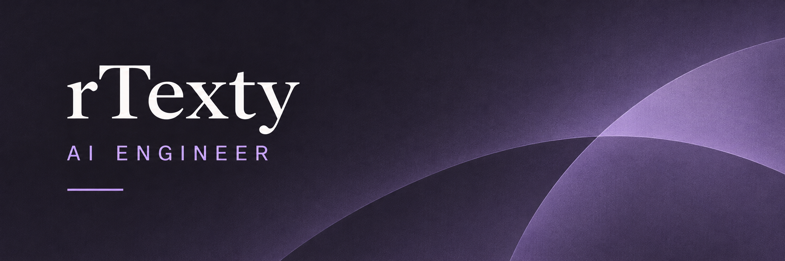

# Hi, I'm Kamil.

I'm an AI / LLM engineer and CSE student at Innopolis University. I explore agents, information retrieval, and the backend systems that bring ideas to life.

 

## Selected projects

**[ktru-match](https://github.com/rTexty/ktru-match)** Product-to-catalog matching with clarifying questions and CSV support. [Explore the demo](https://rtexty.github.io/ktru-match/) · sample scenarios

---

**[OilLine Watch](https://github.com/rTexty/oilline-watch)** A 3D pipeline pressure lab and wall-thickness forecasting prototype. [Explore the demo](https://rtexty.github.io/oilline-watch/?forecast=demo) · synthetic data

---

**[logsLinter](https://github.com/rTexty/logsLinter)** Static analysis for clear, consistent Go log messages.

 

## What I'm exploring

AI agents · LLM applications · information retrieval · backend engineering

## Get in touch

[Telegram](https://t.me/rtexty)
