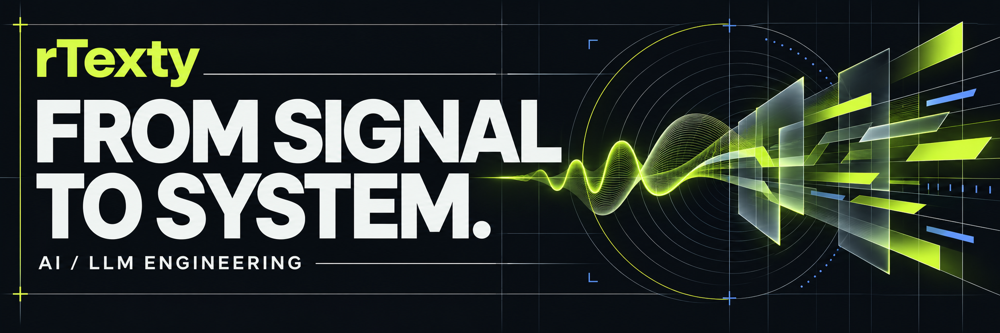
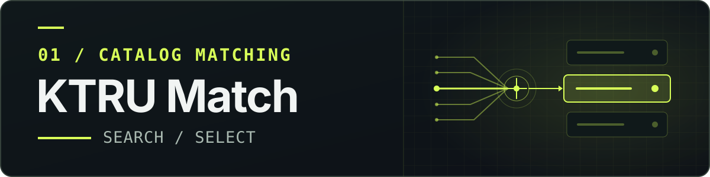
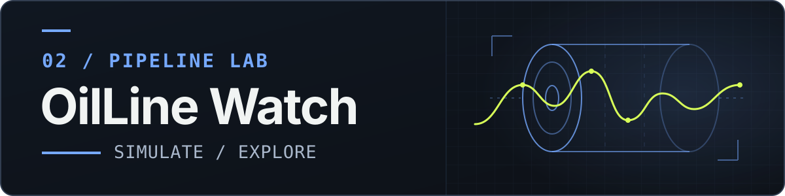
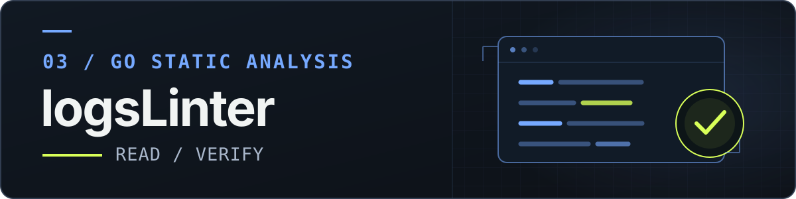

**Kamil Akhmadiev** · AI / LLM engineer · CSE student at Innopolis University

I explore how agents, retrieval and backend systems turn complex inputs into useful tools.

## Selected systems

Matching product descriptions to catalog entries, with clarifying questions and CSV support. [KTRU code](https://github.com/rTexty/ktru-match) · [KTRU demo](https://rtexty.github.io/ktru-match/) (sample scenarios)

A 3D pipeline pressure lab and wall-thickness forecasting prototype. [OilLine code](https://github.com/rTexty/oilline-watch) · [OilLine demo](https://rtexty.github.io/oilline-watch/?forecast=demo) (synthetic data)

Static analysis for clear, consistent Go log messages. [logsLinter code](https://github.com/rTexty/logsLinter)

## Tools & interests

**Languages** — Python · Go · TypeScript **Toolbox** — FastAPI · PostgreSQL · React **Interests** — AI agents · information retrieval · applied ML

## Get in touch

[Telegram ↗](https://t.me/rtexty)
